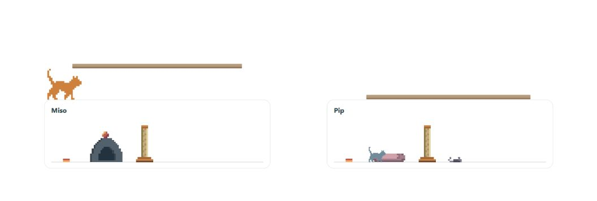
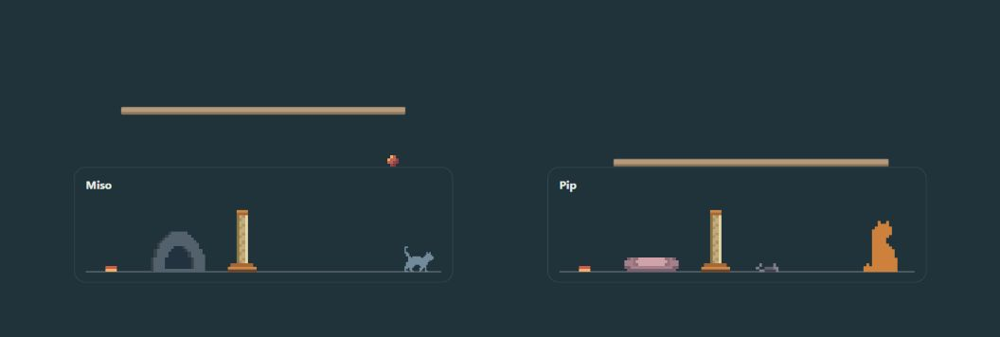

# Pixel Cat Card

A little company for your Home Assistant dashboard. Independent pixel cats wander, rest, groom, watch their surroundings and occasionally investigate toys or each other. Give each cat a comfortable home and let it choose its own pace.



*Real browser capture of the release package. The demonstration contains only cats and their habitat; no personal dashboard data.*

**Release candidate: `1.0.0-rc.1`.** Public Marketplace distribution is being prepared. The repository is currently private; installing from Marketplace is not yet available. A private candidate build is not a stable release.

## What you get

- Independent cats with optional exploration, play, carrying, social reactions and plenty of quiet alternatives.
- Igloo or open beds, bowls, scratching posts and toys. Cat and bed colours are configurable independently.
- Kitten, adult and senior life stages; kittens use a half-size body while furniture keeps its scale.
- An ordinary Home Assistant card picker/editor. One companion card adds one cat.
- Optional controls, labels and performance diagnostics, hidden in the default companion setup.

Cats are decorative: they never operate your entities or press other cards. Runtime playback needs no model, cloud service, Node server or Frame Studio connection. There are no care chores or penalties.

<details><summary>Dark habitat</summary>



</details>

## Install

Target: **Home Assistant 2026.11 or newer**. Older HACS/HA releases have not been validated for this candidate.

Once the public candidate is available, add `Future-Surfer/Pixel-Cat-Card` under **Settings → Marketplace → Custom repositories**, category **Dashboard** (`plugin`). Enable pre-releases to select `v1.0.0-rc.1`. The installer should add one module resource automatically. Reload the browser, then select **Pixel Cat Card** from the dashboard card picker.

Until then, manual testing uses `dist/pixel-cat-card.js` from a verified checkout: copy it to `/config/www/pixel-cat-card.js` and add one **JavaScript module** resource, `/local/pixel-cat-card.js?v=1.0.0-rc.1`. Do not also load the six roaming modules. Verify the build against `dist/SHA256SUMS` before copying.

No user-side build is required for a published release: its assets will include the ready-to-use JavaScript file and checksums. [Install, migration and rollback details](docs/guides/PIXEL_CAT_INSTALL.md).

## Add your first cat

Use **Add card → Pixel Cat Card → Cat companion**. Choose its name, colour, life stage and bed, then save. Add another companion card for another independent cat.

Minimal YAML:

```yaml
type: custom:pixel-cat-home
cat_id: miso
name: Miso
color: '#cd813c'
bed_style: igloo
bed_primary_color: '#52616c'
bed_secondary_color: '#22323e'
show_controls: false
```

Use a distinct `cat_id` for each cat. The existing `custom:pixel-cat-home` type and options remain supported. Picker-created cards enable the recommended companion behaviours; minimal YAML retains the established opt-in behaviour defaults. [Configuration reference](docs/guides/ROAMING_CONFIGURATION.md).

## Updating an existing installation

The candidate bundle retains `custom:stick-pet-card` and `custom:pixel-pet-card` for transitional compatibility. Existing roaming cards keep their IDs, settings and artwork. A new repository name alone does not migrate installed resource paths.

If you currently use six inline/manual roaming modules, follow the [scoped migration and rollback procedure](docs/guides/PIXEL_CAT_INSTALL.md) before switching to the single file. Keep exact old resource backups and hard reload every client. Do not mix both runtimes in one page.

## Limits and support

- This is a release candidate. Marketplace installation, upgrade and rollback acceptance remain release gates.
- Mobile/Companion and PiDisplay performance must be checked on actual devices; a narrow desktop image is not a device-performance claim.
- Reduced-motion preferences suspend the roaming animation. Optional climbing and diagnostic controls have separate documented limits.
- Procedural cat trees and other lab-only features are not part of the default released companion.

For bugs, include the card version, HA version, browser/device, installation method and a minimal configuration with personal data removed. See [security reporting](SECURITY.md) for suspected vulnerabilities.

## Development and artwork

Node.js **22.20+**, no npm dependencies:

```text
npm run build
npm test
npm run verify:build
```

The single-file artifact is generated from the existing ordered runtime modules, retaining separate lexical scopes and unchanged artwork/provenance. The first candidate includes legacy elements for compatibility, so its download is larger than the modern runtime alone.

[Contributing](CONTRIBUTING.md) · [Development workflow](DEVELOPMENT.md) · [Documentation index](docs/README.md) · [Frame Studio](frame-studio/README.md)

Frame Studio is optional authoring software and is not installed with the card. Live stores, private attachments, browser drafts and personal HA backups must stay outside Git and release assets.

[MIT license](LICENSE).
