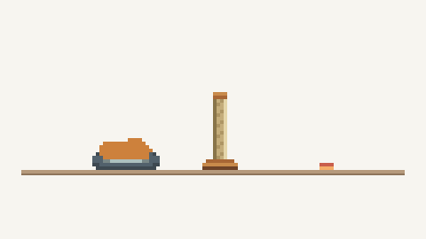

# Pixel Cat Card

A pixel cat that roams freely around your Home Assistant dashboard. Watch it react to its surroundings, wander from card to card, and find spots to nap, scratch or play. Add multiple cats to see new interactions and emergent behaviours unfold.



Choose a name, colour, bed and life stage. Add another card for another cat.

## Install

Requires **Home Assistant 2026.11+**.

[](https://my.home-assistant.io/redirect/marketplace_repository/?owner=Future-Surfer&repository=Pixel-Cat-Card&category=plugin)

Add Pixel Cat Card as a custom repository, then install it from **Settings → Marketplace**. [Release candidates, manual install and migration](docs/guides/PIXEL_CAT_INSTALL.md).

## Add a cat

Choose **Add card → Pixel Cat Card → Cat companion**, pick its appearance and save.

Or use YAML:

```yaml
type: custom:pixel-cat-home
cat_id: miso
name: Miso
color: '#cd813c'
bed_style: igloo
```

Give each cat a different `cat_id`.

[Configuration](docs/guides/ROAMING_CONFIGURATION.md) · [Technical details](docs/TECHNICAL_DETAILS.md) · [Report a bug](https://github.com/Future-Surfer/Pixel-Cat-Card/issues)

[MIT license](LICENSE)
