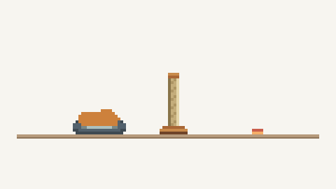

# Pixel Cat Card

A pixel cat that roams around your Home Assistant dashboard. Watch it leave its bed, wander from card to card, and find spots to nap, scratch or play.



*A short scripted demo using the card’s artwork.*

Choose a name, colour, bed and life stage. Add another card for another cat.

## Install

Requires **Home Assistant 2026.11+**. The first HACS release is being prepared.

For now, download [pixel-cat-card.js](dist/pixel-cat-card.js), copy it to `/config/www/`, and add `/local/pixel-cat-card.js` as a **JavaScript module** resource. Reload your browser.

## Add a cat

Choose **Add card → Pixel Cat Card → Cat companion**, pick its appearance and save.

Or use YAML:

```yaml
type: custom:pixel-cat-home
cat_id: miso
name: Miso
color: '#cd813c'
bed_style: igloo
```

Give each cat a different `cat_id`.

[Installation help](docs/guides/PIXEL_CAT_INSTALL.md) · [Configuration](docs/guides/ROAMING_CONFIGURATION.md) · [Technical details](docs/TECHNICAL_DETAILS.md) · [Report a bug](https://github.com/Future-Surfer/Pixel-Cat-Card/issues)

[MIT license](LICENSE)
