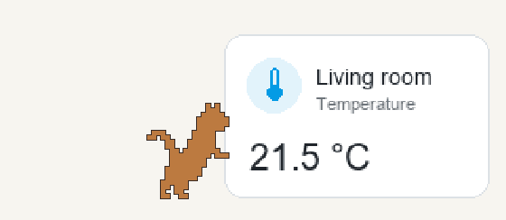
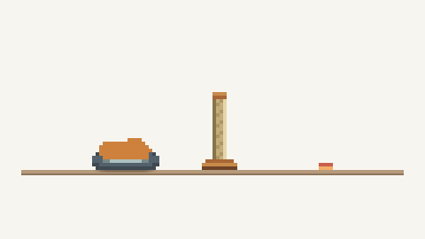
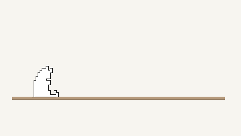
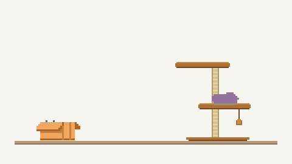

# Pixel Cat Card

A pixel cat that roams freely around your Home Assistant dashboard. Watch it react to its surroundings, wander from card to card, and find spots to nap, scratch or play. Add multiple cats to see new interactions and emergent behaviours unfold.



Choose a name, colour, bed and life stage. Add another card for another cat.

## Install

Requires **Home Assistant 2026.11+**.

[](https://my.home-assistant.io/redirect/marketplace_repository/?owner=Future-Surfer&repository=Pixel-Cat-Card&category=plugin)

In **Settings → Marketplace**, search for **Pixel Cat Card**. If it doesn’t appear in search, use the button above or **Add from link** to add `Future-Surfer/Pixel-Cat-Card`, then install it and reload your dashboard.

[v1.1.0](https://github.com/Future-Surfer/Pixel-Cat-Card/releases/tag/v1.1.0) removes the two legacy card types. [Install manually or migrate an existing setup](docs/guides/PIXEL_CAT_INSTALL.md).



## Add a cat

Choose **Add card → Pixel Cat Card → Cat companion**, pick its appearance and save.

Or use YAML:

```yaml
type: custom:pixel-cat-home
cat_id: miso
name: Miso
color: '#cd813c'
bed_style: igloo
```

Give each cat a different `cat_id`.



[Configuration](docs/guides/ROAMING_CONFIGURATION.md) · [Technical details](docs/TECHNICAL_DETAILS.md) · [Project docs](docs/README.md) · [Report a bug](https://github.com/Future-Surfer/Pixel-Cat-Card/issues)



[MIT license](LICENSE)
