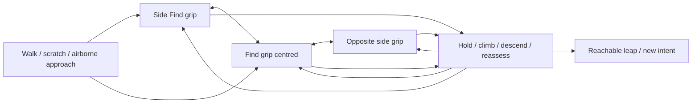

# Climbing workshop and runtime pilot

Open [the climb lab](http://127.0.0.1:8769/prototype/climb-lab.html) with `npm run gaze:lab` running. Route & rhythm uses two compact columns; each setting has a hover/focus/tap explanation. The workshop preserves exact saved art; [the live runtime lab](http://127.0.0.1:8769/prototype/climb-runtime-lab.html) exercises the HA integration. Deployment evidence is in CURRENT_STATE.

## Findings and research

- Current normal jumps use effective body scale: default `cell_size: 2` gives a 180 CSS-pixel adult versus 90-pixel kitten apex budget, before trajectory clearance/headroom. A card above may therefore be unreachable to a kitten even when an adult can reach it. This is a configured game limit, not a biological claim.
- The supplied post/tree photographs show upright bodies, trailing tails, folded/pushing hind legs and forepaws wrapping around the support. The supplied sketch motivates an approach toward the face followed by an exit away toward an elevated landing.
- [WSU veterinary anatomy explanation](https://askdruniverse.wsu.edu/2025/10/30/how-do-cats-climb/): hindquarters propel the cat upward, then claws anchor; descent differs mechanically. This supports separate push/release/catch/hold phases.
- [Niu et al., Journal of Bionic Engineering, 2023](https://pure.bit.edu.cn/en/publications/dynamic-vertical-climbing-mechanism-of-chinese-dragon-li-cats-bas/): dynamic wall climbing depends on run-up, momentum and contact geometry; the studied animals cannot remain stationary on the vertical wall. This supports distinguishing sustained claw-gripping from a brief wall-assisted rebound. It does not justify unlimited smooth-wall hanging.
- Climb gains are authored displacement, not force/traction simulation; a smooth-face rebound is a stylised one-impulse experiment. The general design needs explicit suitable contact geometry/traction. The owner-authorised kitten pilot deliberately permits arbitrary background/card planes as a last resort, without treating them as walls.
- Hop/hold spacing, durations and pixel poses are our adjustable animation interpretation. The lab is not a measured biological simulation.

## Workbench contract

- Seven original AI draft frames: find grip, gather, push, released rise, reach, catch/wrap and grip rest. All are 24x24 grids with explicit AI provenance; editing pixels or metadata changes that frame to mixed. No existing artwork was replaced or receipt completed.
- Pixel painter, per-frame role/contact/hold/native-cell height gain, registration and two paw markers, duplication/deletion/undo, notes and mirrored preview. A second live preview sits beside the pixel editor.
- Shared canvas core (`frame-studio/dist/frame-canvas.js`) powers both editors: buffered left painting, temporary right erasing, interpolated drags, pointer capture/cancel/loss and stable grid coordinates during a stroke. One committed gesture feeds the host undo/provenance/save path. A frame switch cancels the old gesture. Grip/gaze/POI/selection metadata remain context adapters; future common canvas features belong in the shared core.
- Shared previous/next onion skins (blue/pink), shared 0-70% opacity and a green read-only neighbour skin. Choose any sequence/frame from fresh `/api/assets` local saved work or explicitly labelled bundled snapshots; source/version/origin are shown. Refresh re-fetches saved versions. Grid/registration alignment, neighbour mirroring and cell shifts affect overlays only; they never alter exported artwork, provenance, timing or receipts. Skin choices are temporary viewing controls, not draft content.
- Knobs: age, card/post geometry, grip availability, per-hop gain/cadence, grip rest/reassessment time, approach distance/speed, entry ledge height, first grip and recreational climb height. **Destination surface elevation** sets the landing geometry; **Leap rise available from grip** is a normal jump budget in native cat cells, scaled with body size. The solver derives the first reachable release grip from those values. Post height bounds available contacts without changing that intent. If it ends too soon, the cat holds at the highest usable grip and can reassess, descend or take another reachable exit. No percentage-based release preference remains. Playground edits preserve relative playback progress. Selecting or editing a frame seeks to its first occurrence in the route.
- Planted frames have zero gain. Only released frames translate upward, with a quick ease-out; the final cycle frame must catch the post. A semantic rest tag scales hold timing independently of frame names. Near cells wrap in front of the post in every phase; the larger close-up exposes registration/contact errors.
- `auto` prefers a reachable ordinary jump; `climb` deliberately tests gripping cycles; `rebound` allows one contact cycle; `return` climbs for its own sake and springs back to the floor. Non-grippable faces reject sustained climbing. All faces remain pass-through.
- Planning runs only on edits or an explicit grip decision, with at most 32 climb cycles and 96 flight checks, including the return check. Repeated release probes are cached within the plan. Playback binary-searches precomputed phases; no per-frame route search. Release/landing use the existing runtime `planJump` / `jumpSample`, including their height/speed/headroom limits and original flight artwork. Body-centre registration preserves the release position; direction follows the actual exit.
- Each grip is a stationary support node with reachable hold/up/down/upper-card/floor choices. Pause at next grip, choose an edge, or continue the planned route. A terminal hold stays put; manual decisions preserve the exact grip position. This is an interactive route-graph prototype, not yet autonomous runtime decision-making. Invalid routes explain the face/landing/cap failure; the separate return check does not certify an authored descent.
- Ten entry previews use existing runtime gait/scratch/flight artwork: walk, meander, trot, gallop, sneak, scratch, jump-up, pounce, entry-ledge leap and already gripping. Airborne entries end at a registered Find grip pose instead of playing ground-landing frames. Stand/loaf/alert-lying can follow an exit landing.
- Downward steps reverse the existing cycle as an explicitly labelled draft, moving only in released phases. Body/paw bounds prevent descending through the floor. Front/behind rotation edges now use separate rough draft clips in this lab; they are not approved runtime artwork.
- Default 210px-high fixture at base cell size 3: adult can jump directly; kitten requires six climb cycles. Its normal direct return exceeds the current drop limit. This is deliberately visible as a review boundary, not silently bypassed.

## Draft safety and checks

- Browser recovery uses `pixel-cat-climb-lab/v1`. Durable local saves use `GET/PUT /api/climb-drafts/climb-main` on 8769, with ETag preconditions, immutable snapshots in the local Studio journal (`kind: climb`) and exact history at `/history` / `/versions/<hash>`. Routine Studio review now discovers these versions. The main Studio Asset changes page previews climb frames, gain/timing and metadata differences and opens the climb workbench.
- Autosave keeps an immediate browser recovery copy, coalesces durable writes for 700 ms and serialises in-flight edits. The visible saved timestamp/hash confirms acknowledgement. On offline/error, retry is explicit; the browser copy remains. Browser/server startup differences and stale-tab conflicts appear above the preview: choose Use saved frames (backs up browser copy) or Keep this browser's frames (retains prior immutable versions). The autosave base hash is paired with the exact working draft, rather than trusted as a shared bare hash; a cross-tab edit stops automatic saves until resolved. WIP remains saveable independently of playback validity.
- `?draft=qa-<name>` isolates both browser recovery and server journal under `.studio-data/climb-qa/`; QA saves never appear in the live journal. No hosted save, ordinary Studio project/prop overwrite, HA deployment or receipt completion. Import/replace/restore requires a verified local recovery backup first (20 distinct snapshots); history previews/export preserve exact frame IDs/rows/contact/gain/timing/origin/notes/config. Older drafts gain missing controls without changing artwork.
- One route plan, clock and set of edited frames drives both preview canvases and both Play/Next phase controls. Lab-only contact preview tolerates unfinished forepaw pixel guides, with explicit warnings and unchanged markers/artwork; structural constraints (planted gain, cycle catch, valid timing, bounded reach checks) remain enforced. Default strict planning still rejects unreviewed paw contacts. Malformed/oversized imports preserve the current draft.
- Focused tests exercise 72 age/scale/intent cases (64 playable, including held/unreached goals), 1,230 planted phase holds, ten entry neighbours, registered grip landings, same-position decisions, draft descent, destination-elevation/budget effects, post-height-independent release and unreachable-top reassessment, explicit rotation gates, lossless migration, bounded failure, grounded landing contacts and WIP preservation. The default age comparison uses the actual generated runtime rather than a parallel ballistic approximation.
- Full verification: 100/100 suites, reproducible builds and unchanged runtime release integrity (`snapshot-82871fe68cfe0a88`). No receipts completed; the preserved owner climb draft now has its own pending version. Original climb frames and ordinary Studio artwork remain unchanged; only new clips and metadata were appended.
- Browser checks cover exact-cell left/right painting in both editors, one-stroke undo/redo, original gaze/POI right-click actions and exact autosave readback, plus two-column controls/tooltips, exact autosave readback, reload recovery, competing tabs and Studio journal discovery, plus all ten entries, grip hold/up/down decisions, scratch entry, destination/leap controls and error-free playback. Earlier checks covered pixel edits and actual JSON download/reimport. The owner draft is exported privately before work; QA controls never share its storage key.

- Depth cell borders use the shared `drawCellMarks` canvas renderer; stroke gestures and undo/save adapters remain unified. Depth-only changes appear as `depth` metadata in Studio version diffs, with zero artwork pixel changes.

- Contact previews use crisp enlarged pixels: the route inset crops 32 native cells from a clean scene buffer; the workbench follows the same live animation at 10 pixels per cell. Neither preview modifies artwork.

- Reset playground settings changes only config. Starter artwork replacement lives in Draft management, requires confirmation and a verified backup, and flushes the old durable draft first when connected. Saved-version history and local recovery backups both support direct restoration.

## Contact guide vocabulary

- **Post anchor**: orange registration point; positions the whole frame relative to the post grip.
- **Forepaw A/B**: existing two green guides on the intended visible paw pixels, independent of drawing depth. A/B does not assign near/far or rear feet. Moving a guide does not repaint or reposition the cat.
- **Always near / Always far**: optional per-frame `depth` grid (`.` auto, `N` near, `F` far), separate from artwork rows and contact points. Solid cyan / dashed violet cell borders are editor-only. Tools annotate existing ink; they do not create pixels or change silhouette/body centre. Legacy `R` wrap ink defaults to near; explicit far overrides it. Depth applies in every phase, so it can describe paws, heads or tails. Body/erase clears the override on painted cells. Shape validation rejects masks on empty ink.
- **Contact phase**: planted/released movement constraint. Rear-paw contact is currently a phase label, not a separately tracked foot. The UI explains this explicitly.
- **Next model**: four optional named paw guides (front-near, front-far, rear-near, rear-far), per-frame support/wrap intent, and a separate registration point. Near/far is relative to the viewer and must behave consistently when mirrored. Preserve legacy A/B until explicitly assigned; do not infer anatomy from pixel positions. First add an additive authoring adapter and evaluate existing frames, then use reviewed contacts for placement/occlusion and grounded push checks. Near/far depth masks already work independently of these future paw identities. No automatic artwork edits or new global pathfinder.

## Rotation drafts and baseline tuning

- Workbench picker edits `frames` (climb), `rotations.front.frames` or `rotations.back.frames` through the same painter, onion skins, undo, notes, depth masks and exact autosave path. Each turn has eight rough poses: Gather hind legs, shifting/tucking, frontal wrap/regrip, emergence and the mirrored Gather endpoint. First-frame pixels/contacts come unchanged from the owner's saved Gather pose; transformed poses are mixed and new centre poses are AI drafts. Each clip records its source frame/version and remains unreviewed.
- Turn progress (`around`, 0-1) maps the grip between the post's two sides without height gain. Reverse traversal reverses the same clip; near/far masks stay relative to the viewer. Rotation holds use authored durations, Phase cadence and optional Grip rest scaling. Nonmonotone/incomplete progress stays saveable WIP but blocks route playback until repaired.
- Centred-post scenario: climb on the left, rotate in front or behind, then use the normal runtime trajectory/landing on the right-hand card. Release height is derived from the destination and the actual post-rotation pose/jump budget. At least one climb cycle is exercised by this fixture. A side change is also an optional edge from any gripped node; after turning, the cat can hold, continue mirrored climbing, turn back or spring outward to the floor.
- Unreachable destinations stay unreachable. While editing a turn, the lab can show the turn at the held grip and explicitly label it as an authoring-only preview, ending in reassessment rather than inventing a successful leap. This shares the bounded route plan and clock; no second animation player or global pathfinder.
- Controls separate **Cat-behaviour baselines** (gain, phase cadence, rest, leap rise, reassessment and recreational climb) from **Simulation and entry setup** (geometry, run-up, entry preview speed/height and plane colour). Blue ticks show source-defined system values, independent of the last browser positions.
- Adopted baselines: **120 ms Grip rest**, **30-cell leap rise from grip**, and **1x climb gain = twice the original frame-authored gain**. Phase cadence stays 2x. Config `gainBasis: 2` makes the gain change explicit; old saved multipliers are halved on import without changing their physical distance. Conversion is idempotent, never edits frame data or immutable history. Grip rest retains its authored-duration/260 reference and subsequent cadence scaling.
- **Submit as defaults** saves `defaultProposal`: UUID, timestamp, pending status, prior saved version, exact behaviour values, system values, gain basis and labelled/unit-bearing definitions. Scene/entry settings are excluded from new submissions. Older proposals remain exact, including their original units/geometry; only the three explicitly requested baselines were adopted from this round. A proposal is an immutable Studio journal version, not an automatic HA update. Repeated identical submissions reuse it; failed/conflicting saves cannot report success.
- Studio Asset changes previews/diffs include all clips. Default submissions are highlighted in the saved-version summary and displayed as proposed vs system values. Future review must retrieve the exact snapshot, separate geometry preferences from behavioural parameters, and consume reviewed baselines through bounded category/mood/age modifiers with independent actor clocks. The scenario is a test fixture, not a compulsory canned behaviour.

## Next review / runtime gate

1. Owner tunes upright silhouette, wrapping hands, hind-leg tuck/extension and hop/rest cadence; export a draft for review. Distinct climbing/descent/exit poses may still be needed.
2. Add reviewed descent or alternative return routes; then test entry/release contact continuity and departure/landing artistry beyond the current rough orientation draft.
3. Integrate cached explicit face geometry/affordances into the existing bounded route graph, with horizontal-to-grip and grip-to-grip landing edges, both-way traversal, optional hold/reassessment, side identity and existing route costs. A grip must support changing intent, not require completing an entry-to-exit macro. Do not add a second global pathfinder or treat all vertical edges as solid/grippable.
4. Handle moved/removed/hidden faces/targets, remounts, pause/resume, carrying eligibility, reservations/occupancy and interrupt/escape alternatives in controlled lifecycle labs before HA.
5. Choose climbing through category/tag profiles and independent optional clocks. Kittens may favour energetic opportunities; no compulsory climbs, chained crowd scripts or stranded residents. Only deploy a scoped runtime pilot after artwork and both-way routes pass review.

## Centred supports and contact effects

- The [refined front baseline](../../frame-studio/user-sequences/centred-climb-2026-10-20/README.md) is frozen from owner-approved saved work. New clips clone it; existing saved artwork is never auto-reseeded. Behind uses identical pose geometry/timing/contact data with depth reversed. Exact baked-frame status disappears after further edits; runtime adoption remains separately gated.

- `centred.front/back.frames` are separate editable clips: Find grip centred, gather, push, released rise, reach, catch and rest. Front now has a reviewed lab baseline; behind remains a depth-review draft. They use the shared painter/onions/undo/autosave/journal and preserve source lineage and AI/mixed provenance. Existing side-climb and turn artwork is never regenerated.
- Landing grip is independent of entry gait: jump, pounce or ledge entry may land directly in a centred pose, using the existing jump planner and ordinary entry budget. An explicitly grippable flat-plane fixture exercises this without requiring a side Find grip. Faces remain pass-through; this does not enable HA card climbing.
- Support identity is left, centre-front, centre-back or right. Partial rotations stop at a centred grip with no height gain. Up/down uses that support's pose family; hold, climb, descend, turn to either side and reachable departures remain optional edges. Changing front/back arcs first visits a side. Descent reverses current poses as a labelled draft, pending authored review.
- The side/centre/other-side fixture demonstrates one possible route, not a behaviour prescription. Destination elevation and the existing bounded flight envelope still determine release. An unreachable goal ends in a usable held support; no successful leap is invented. Flat-plane grips can leap directly without a post-side turn.

- Lab catch events capture exact forepaw guides, material, depth, support ground and route time. Sparse debris uses the existing rope recipe, surface colour and foreground/behind policy; holding emits nothing. A bounded, scrubbable preview adapter samples route events rather than running another actor/world simulation. Reduced-motion disables drawing. Runtime post catches use the existing bounded material-colour rope pool and wiggle helper; virtual-plane catches and slips now share material-coloured debris and bounded surface-local marks.
- The flat-plane lab now previews two or three short claw marks per paw catch, drawn on the material beneath the cat. Light surfaces darken; very dark surfaces lighten using relative luminance. Marks use surface-local contacts, clip to the face, fade within eighteen active seconds and cap at 960 preview contact marks. Holding emits none; rewind is deterministic; behind contacts, removed faces and reduced motion suppress marks. Plane colour is a simulation control for contrast review.
- Scene rendering has one ordered compositor: background fixtures, far effects/authored far cells, prop, surface marks, foreground actor cells, foreground effects. Runtime approaches, entry/exit flights and landing/settle poses draw in front of props; registered climb/rotation frames retain their explicit near/far masks, including released climb phases. The clean composed scene feeds both magnified previews. Props are not repainted over ordinary movement.
- Future real-card/wallpaper integration shares these events and material policies with particles, adding actual moved/removed/hidden surface lifecycle handling and cached rendering in the existing effects framework. Marks must never alter card content or intercept controls. Claw grips/material response remain explicit capabilities; arbitrary visible vertical edges are not automatically safe/grippable.

## Runtime pilot boundary

- Sixth optional module `pixel-cat-climbing.js` packages the shared lab planner and the exact 37-frame snapshot `120f98458440de442be20700c716d3e999a4060bc1b33a22ed217756b476ded2`. Preserve all mixed origins and newer Studio work; tuning is applied without rewriting the stored draft.
- Ordinary surface/point routing takes priority. Kitten plane edges are a last-resort route fallback to a real supported landing. No card collision or new global clock/search is introduced. `climbing: false` disables climbing; `plane_climbing: false` disables only the kitten plane experiment.
- Post leisure remains optional and individually cooled down. Fit derives from body size, grip span and authored gain; ordinary posts fit kittens, larger cats need taller posts. Initial runtime approach uses the left face; grips can turn in front/behind and continue from the other side. Right-face approach and distinct descent art need review; descent currently reverses the existing cycle.
- Baseline: 120ms rest, normalised 1x gain (old 2x), 30-cell grip release rise, 2x phase cadence before profile cadence. Rotation changes timing/interpolation only, preserving pixels: quick transfers separated by a centre catch.
- At grips, choose optional continuation/hold/descent/rotation/exit with individual mood weighting. Only checked real landing flights finish a journey. Destination removal or changed geometry initiates recovery; uniform scroll translates rendering/landing coordinates and pause freezes the climb clock. Carried toys are excluded in this pilot.
- Post body/wrap depth uses a separate far overlay with the existing scroll/depth lifecycle. Virtual background climbs render in front, including entry/exit flights. Runtime marks sample painted CSS backgrounds, including pointer-transparent home cards. Surface-local layers preserve scrolling/layout attachment; post scrape layers clip to rope and sit between far body and near paws. Unknown material/interactive controls skip marks.

## Grip intent and contact refinement

- Destination-led movement aims at a reachable release band from the production flight planner, rather than flipping direction at guessed foot height. A bounded seven-point scan is cached per pose/landing. Hops shorten near the band; explicit half-hop edges are available in the workshop. Landing X honours the surface's snapped stance bounds.
- Blocked landings get a brief quiet wait and one recovery intent; failed automatic destinations are avoided for 45 seconds (at most eight remembered targets). Explicit commands can retry. Recovery does not keep resetting its deadline. No per-frame route search is added.
- Recreational post visits permit at most one optional aspect change. Reaching the highest grip or beginning descent commits that bout to returning; it does not resume upward hops/orbiting on each grip decision.
- Descending occasionally substitutes a short scrape-and-catch slide. Prolonged stationary grips can also slip slightly; other actions reset that stationary timer. Slides reuse the held pose and explicit sliding contact, have a ten-second per-bout cooldown and can be disabled with `climb_slips: false`. No care penalty or new artwork.
- Marks: centred, continuously scaled claws (two for small actors, three for larger), full contrast for roughly twelve active seconds, fading by eighteen. Catch marks extend two actor cells; scrape length comes only from actual paw travel. Each sliding paw keeps a camera-independent previous contact. Its segment splits at measured card/material boundaries, with bounded probes for other painted elements; re-entering a material or crossing an unpaintable gap starts a new run. Hit-testing skips cat/prop/effect overlays, including nested shadow roots, so a moving paw cannot hide its underlying material. Source/guest home cards use the shared geometry cache. Decal SVGs go into the host shadow root when it has no default content slot; ordinary/slotted hosts keep the existing light-DOM mount. This is required by HA sections/background hosts, whose light children are invisible. Original host isolation and all layer nodes still clean up normally. Material rectangles refresh once per contacted effects frame when their viewport position changes, preserving local trail coordinates while scrolling. Widths stay actor-scaled; host/rope clipping and material depth still apply. Caps: 960 per actor, 3,840 per view, 64 surface layers; per-owner/layer counters avoid nested scans. New contacts always replace the least recently refreshed eligible mark at capacity (owner pressure stays within that owner), reusing its path node. Refreshed slide trails keep their slot and restart the same 18-second expiry. A new material retires the least recently marked layer at the layer limit, restoring its original isolation; no capacity gate silently rejects valid contacts. The lab counts logical births/replacements explicitly, including node reuse. `climb_marks: false` disables marks; `effects: false` and reduced motion suppress them. Existing shared effects time and particle pool/lifecycle are reused; no new RAF/observer. Surface rectangles refresh only with geometry changes, with one shared portal-box sample for affected frames.
- Runtime lab: pause at a grip and preview half up/down hops or a scrape; one-second stepping supports contact inspection. These are lab-only actions and do not change Studio drafts/defaults.

## Dashboard boundary contract

- Runtime grip limits account for authored ink around the registration point, including rotation/centred poses. The world is the scrollable dashboard rectangle, not the visible viewport; ordinary scrolling translates routes and boundaries together.
- Release candidates use the actual world ceiling and bounded full-pose flight checks. A tiny edge stance can be unusable if the flight art extends outside the world. Reject that exit and return/reassess.
- Fresh support membership and world containment gate destinations. Recovery rebases from the displayed contact with its camera offset intact. A cheap cached-ink guard prevents drawing an escaped pose after geometry changes; no added discovery loop, observer or global clock.
- Runtime lab offers near-top/left/right and outside-world ledges, with a displayed outside-world sample count.

## Runtime pace, descent and scroll ownership

- Default ascent doubles the earlier movement and decision cadence. `climb_speed` (0.25-3, default 2) scales existing pose timing and grip pauses; age cadence still applies. Saved Studio timing/default proposals are untouched.
- Virtual-plane descent usually chooses long slides (85% of downward choices), retaining occasional hops. `climb_slide_chance` accepts 0-1; `climb_slide_max` is a baseline maximum in cat cells (16-320, default 320), varied per slide and capped by the release band. Existing `climb_slips: false` disables both slides and accidental slips.
- `climb_release_drop` (8-100 cat cells, default 36) controls preferred remaining drop before a checked floor release, with small individual variation. Sliding stops at the selected reachable band; it does not blindly continue to ground level. Ordinary routes still win over plane climbing.
- Long scrape strokes extend existing nodes, sampling contacts at most every 50ms. Wall/card decals are isolated negative-depth children of their actual material, beneath props/content/cats; original inline isolation is restored on cleanup. Post-face marks retain their separate rope depth/clipping.
- Climb movement, bout age and grip duration share the same accepted step: at most 50ms per visible callback, with gaps over 1000ms suspended consistently with the actor. Repeated 250-1000ms callbacks no longer freeze only climbing or spend its timeout without motion. This is bounded progress, not unlimited catch-up.
- Debug labels identify rests, approaching the release band, landing clearance and unusable geometry. DOM counters expose active milliseconds, wait milliseconds and slow callbacks; genuine all-landings-blocked holds remain safe. Recovery retries every 1.8s while holding exact pixels; it never resets to stale ground on a failed recovery plan.
- Post debris uses actor scale; colour and clipping still belong to the material. Contact sampling includes camera translation; marks inside the rope keep their actual paw X instead of snapping to its centre.
- The displayed climb pose retains its matching scroll camera until a translated pose is ready. Generic ground repair does not relocate gripping actors. A blocked/removed landing holds exact visible ink, checks free alternatives and retries; timeout cannot silently hide/reset the cat to its stale support.
- Runtime lab includes explicit wall-descent preview, release/slide/speed controls and scroll buttons. These alter only the disposable lab actor.

## Stranded descent recovery

- A failed release band gets a short grip wait (about 1.2 active seconds, or the existing bounded retry count), then a single recovery intent. Fresh, clear real supports below take priority over returning toward an unreachable upper goal.
- Recovery can scrape/slide down toward that support; slipping may be disabled with the existing climb setting. World/ink bounds, actual landing membership, occupied landing checks and full flight checks remain mandatory.
- After two recovery seconds, downward fall comfort increases from the ordinary 110-cell limit by 25 cells per active second, bounded by remaining dashboard depth. Flight time is allowed to grow for that checked downward release; upward reach and ordinary voluntary jump limits stay unchanged.
- If every real landing is blocked or absent, preserve visible contact and retry. Never fabricate a floor, teleport to stale ground or fall outside the dashboard.
