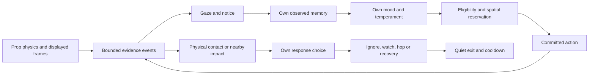

# Interaction system — implementation and next experiments

> Planning authority: [ROADMAP.md](../../ROADMAP.md) is the only active vision/task backlog. This document is an operational reference or dated engineering record; earlier proposed steps are not a separate delivery order.

16 October 2026. The five interaction milestones now have an opt-in implementation, using existing reviewed artwork. They remain a same-surface pilot rather than a general crowd/rigid-body simulation. Enable `mood_behaviour`, `social_behaviour`, `interaction_behaviour`, and optionally `prop_reactions`, `landing_reactions`, `startle_followups`. The new flag defaults off. Debug controls expose the flag and temperament; normal relaxed exploration remains available.

## Shared structure

### Casual wandering, scratches and readable moods (16 October)

Relaxed uncommitted exploration can sample a casual 6-cell/second walk alongside the existing 9-cell/second stroll. Speed and frame timing share the same contact clock. Ear scratching now uses 3–7 whole authored cycle repeats with one entry/exit; its deadline covers the bout, while incoming physical startles remain eligible. Mood/action labels default on, use categorical red/black/green/purple text and remain independent of the now-default-off glow. No new artwork was created.

### Calmer resting follow-up (16 October)

The authored loaf cycle now holds the first low-head cycle frame for eight seconds and the lifted-head cycle frame for 1.2 seconds at normal idle timing; entry/exit timing and artwork remain exact. Autonomous loaf/sleep bouts last 15–25 / 25–45 seconds, and extend the exploration deadline to cover the chosen rest. Company resting extends its own horizon when choosing one of these poses. This replaces the old rest_ms/3 loaf cap (about 3.3 seconds at the playground default) without slowing unrelated idles, play clips or forced previews. A resting source does not roll unsolicited encounter initiation, but remains susceptible to real physical disturbances and user commands.

Sleep's mood selection factor is multiplied by max(0.01, (1-alertness)^3), keeping sleep possible while making high-alert sleep much less likely. Loaf/yawn are suppressed more gently. Moods remain independent influences; the renderer does not relabel an alert cat as sleepy just because a sleep pose was selected. Cheek-rub greetings and jump-up artwork refinement remain explicitly deferred in ROADMAP.

### Surface borders, physical impacts and quieter spontaneous play (16 October)

Every discovered card now supplies an inset bottom-border layout candidate, including custom cat-card roofs in the bilateral shared-home stress mode. It uses the card's measured bottom, not a guessed content floor, and the existing candidate opt-out, width, jump and return-route checks. It is still decorative foreground support, not evidence of an actual physical shelf. The original home dock remains separate.

A high landing can be heard within 28 cells of the larger cat's scale, allowing up to 12 cells of support-height difference and adjacent card elements. Publisher view isolation remains enforced. A close rear impact strongly favours hopping, with independent watch/ignore outcomes; gaze does not gate this physical cue. A chosen safe hop now interrupts grounded walking (including slow stroll, trot and grounded gallop), sitting, loafing, sleeping, grooming, scratching, previews and committed play/routes immediately. Commands/episodes are cleared only after a safe escape plan exists; toy claims are released and social ownership is ended. Ignore/watch during movement preserves the current movement. The old next-walk-cell landing queue is removed. A jump or airborne gallop beat retains its physical flight and defers the already-chosen hop until landing; queued reactions expire, preserve source-relative geometry through scrolling, and clear on commands/cancellation. Pause/hidden/unavailable/cooldown and safe width/headroom/corridor checks remain hard guards. No reciprocal high-landing cue is emitted by a startle hop.

Stimulus-free playful episodes are now considered only after 60–120 seconds, with a much lower mood-weighted chance (roughly 0.025–0.145 before sleepiness), instead of a 20-second retry at roughly 0.1–0.75. Explicit play previews and observed cat/toy invitations retain their own rules. This reduces random air-hunting without reducing the sight/contact-driven interaction probabilities.

Idle playback now rebases front versus authored anchors on sequence entry and exit, including sniff, scratch, yawn, sleep and voice poses. Loaf bridge frames initially use their own contact; entering the target sequence rebases again using the last displayed bridge frame. Human pixels are unchanged. This fixes coordinate slides; missing or visually abrupt authored transitions between different silhouettes still need sequence-pair review rather than a claim that every transition is finished.

### Natural encounter follow-up (16 October)

The first stress-view observation exposed an integration gap: successful forced lab encounters did not imply frequent opportunities in ordinary exploration. All ten cats had the same mood baseline (playfulness stayed exactly 0.40), social invitations were considered only at destination decisions, and different small card roofs rarely provided simultaneous idle partners. Quiet company did occur, but this did not establish visible playful interaction frequency.

The opt-in interaction layer now samples observed neighbours every 1.8 active seconds while idle or at a completed walk boundary. An ordinary non-command walk can probabilistically finish at its next planted cell after noticing an available companion ahead (checked at most every 2.5 seconds). It retains its authored gait/contact clock; jumps, gallops, sneak segments, commands and previews are not truncated. Safe same-surface pats/ambushes compete with continuing exploration. Apparently unaware companions receive a stronger ambush weight based on their last observed gaze, not private awareness. Different surfaces remain ineligible for direct social attacks; exploration instead gives surfaces containing a recently observed idle companion a soft weight bonus. Visit recency and safe return routes still apply.

A passing acknowledgement is a brief look toward an observed nearby cat, leaving the other cat's movement untouched. Its bounded personal 12-second greeting cooldown is separate from the 30-second play-pair cooldown, so a greeting cannot suppress a later stalk/pounce opening. Physical surprise now has a more noticeable hop probability, while ignore/watch and safe-hop fallbacks remain possible; gentle pats still strongly favour calm outcomes.

Mood baselines and slow 65–140-second rhythms derive independently from each cat's seed. Rest reduces sleepiness and restores playful interest; noticing a cat can raise curiosity/alertness at most once per companion per 15 seconds, and initiating play adds slight fatigue/alertness. Explicit baseline overrides and manual holds remain supported. These are animation design weights, not a biological simulation or mandatory behaviour script. Labels retain dominance/hysteresis rules, so a genuinely mixed cat can still say balanced.

Behaviour & mood includes an encounter summary: checks, eligible opportunities, starts, acknowledgements, visible and same-surface companions, current pat/ambush counts and cooldown. These are eligibility/attempt counters, not successful-contact counts. Actual contact and completion remain in the decision trace. The same JSON is exposed on `data-encounters` for read-only lab inspection.

`prototype/cat-interactions.js` extends the existing decision layer. The generated `pixel-cat-behaviours.js` contains perception, decisions, interactions and debug; artwork/extras retain exact grids and provenance. Install all four modules as documented in README. The inline HA tool enforces 128,000 bytes (decimal), now checked by the build and tests. The split removes the inline resource size bottleneck without adding a backend or runtime dependency.

Each visible view has a weakly held interaction world: a bounded event journal (64), current prop observations, active-time clock and bounded pair cooldowns (128, 30 seconds). Displayed raw gaze still supplies visual knowledge. A cat separately owns last-seen snapshots, notice confidence, intention and one active episode. Live registry geometry is used for safety and availability, never as hidden target knowledge. Reservations include the initiating cat's destination and existing motion sweep; a recipient remains free to continue its own activity or leave. Leaving/busy recipients end the approach. Explicit commands and previews win over voluntary social invitations; an accepted physical startle is a separate immediate interruption. No forced relocation, homing jump or guaranteed hit is used.

Event envelopes and debug cue fields contain scalars only; card elements stay in internal geometry registries so HA’s circular custom-element references cannot break logging. Events describe evidence, not a required reaction. Physical brushes, actual paw contact and nearby play landings can be felt without sight. Visual prop motion requires real finite-range gaze and notice dwell. Cue identities and the existing shared six-second recipient reaction cooldown prevent repeated rolls. Pair cooldowns, one role swap and bounded episode horizons prevent retaliation/chase chains. Startle recovery does not emit a new play-landing cue.

## 1. Sudden motion through gaze

The shared prop update detects actual movement following at least 900 active milliseconds stationary. Spawn, layout changes and jitter establish a silent baseline. Claims do not change mouse scheduling. Events expire quickly; current visibility and roughly 120 ms motion notice are required before reacting. Unknown/blind frames cannot discover moving props. A visible nearby onset can yield ignore/watch/hop; a distant onset offers attention/play, not a distant startle. A cat does not respond to its own ball strike as another actor's surprise.

The same mechanism accepts a scripted lab roll or a genuine ball strike; the lab labels its scripted stimulus explicitly. A noticed object can offer a shared-play decision immediately, rather than waiting until a long idle ends. Observation alone grants no play ownership. In the new mode, the older automatic toy-hunt path also requires a fresh visible observation, uses its observed position/facing, and stops refreshing an unseen target. Explicit forced debug hunts retain their deliberate bypass.

## 2. Gentle social pats

A recent observed companion on the same broad surface can offer a pat opportunity. Candidate placement uses the authored bat contact and the observed recipient silhouette at the paw height. Torso overlap is rejected; some orientations/postures legitimately offer no reachable pat. The initiator uses a relaxed approach. The recipient is not forced to sit, wake or reciprocate. A changed observation, command, obstruction or timeout ends the approach.

The existing complete bat clip supplies the visible motion. A cue is emitted only at its authored contact frame when the displayed paw meets actual opaque recipient pixels. The recipient independently chooses ignore/watch/hop, with gentle pats strongly favouring calm outcomes. Misses and leaving recipients are valid endings. Pair cooldown applies even when an approach is abandoned.

## 3. Sneaking and ambushes

Observed idle companions, including sleepers, offer optional playful approaches. The source uses short authored sneak segments, checks its last observation, then can abandon or pounce beside a reserved target position. Apparent visibility is inferred from the observed pose/gaze, not the other cat's private awareness or mood. Being apparently noticed raises disengagement probability but does not force it.

The committed jump is not retargeted. After real landing, a sufficiently nearby footprint (up to 14 source cells of silhouette gap at the larger scale) emits a localized play-landing disturbance. This is a nearby impact cue, not a claim that two bodies collided. A distant landing is a miss. Sleepers can ignore the cue; safe hop/retreat/counter-play remains optional. Counter jumps do not recursively publish play-landing events.

## 4. Chase endings

The existing mutually noticed invitation still has independent ignore/watch/run replies. The richer pilot permits a safe same-surface catch attempt, disengagement, runner distraction by an observed prop, or at most one role reversal. The initiator's willingness to pounce and the recipient's ending choice are sampled separately from their own moods. Reversal requires the runner to have noticed the chaser. Catching up does not guarantee contact, surprise or a response.

Observed positions, full landing room, third-party corridors and normal ballistic plans constrain catch attempts. The shared episode has a ten-second ceiling as well as the ordinary local horizon. Lost observation, removed actors, commands and unavailable space terminate it. Ambushes and chase catches share the same nearby-impact geometry predicate. Cross-surface pursuit and a general pedestrian collision solver remain future work.

## 5. Shared toys and temperament

Several cats can notice one ball; only one can reserve an interception. A source retains its toy during active paw strokes. In settle/groom, its completed interaction can release the claim, allowing another actor after 400 ms while retaining the original actor's repeat cooldown. The source can finish grooming without cancelling the new owner's claim. An interception attempt then leaves a one-second quiet handoff interval, with a longer personal repeat cooldown.

An available watcher uses a recent observation and known rolling friction to propose a landing, refines once against the actual ballistic duration, then commits. No airborne live tracking occurs. Falling balls, unsafe geometry, missing observations and active claims reject an interception. Existing real ball/paw contact checks decide the final impulse; a miss is logged and released. This is a first interception policy, not a guarantee of catching fast toys or following them across surfaces.

`temperament` optionally supplies bounded `boldness`, `sociability`, `curiosity`, `patience` values (0–1). Otherwise stable values derive from actor identity without consuming its mood random stream. Boldness influences surprise/play, sociability invitations, curiosity prop interest and patience action horizons. These preferences persist for the actor's session; mood still drifts independently. Debug sliders are temporary client settings, not an HA configuration save or shared backend personality.

## Validation and reflection

`scripts/test-cat-interactions.mjs` exercises actual pat/ambush tick progression, both facings and scales 1–3, physical hits/misses, independent recipients, onset/gaze/notice/blindness, event deduplication, original-view reservation cleanup, Home, exclusive claims, stroke-to-groom handoff, fixed interception endpoints, real ball impulses, chase endings, bounded clocks and temperament probability differences. Six seeded ten-actor schedules additionally exercise finite motion, bounded traces/events, episode ownership and cancellation cleanup. The full regression suite protects existing art, gait contacts, physics, Studio saves and previews.

The social lab offers controlled pat/sleeper/ball fixtures, real normal exploration, a third watcher, seeded moods, eligible-opportunity controls, event traces and performance export. Fixture posture holds, explicit prop placement on the reset surface and scripted ball rolls are identified explicitly. The fixture prop placement does not relax HA’s normal spawn/return-route checks. An eligible opportunity button does not force a recipient response or a physical hit. Compare foreground features off/on and inspect traces; short FPS readings are not hardware-wide budgets or real-phone validation.

The implementation reviews produced two important refinements: committed jumps must count as available to their own episode, and approach reservations must not freeze an unaware recipient. Both now have regression coverage. Interception refinement also retains the first safe plan when a second prediction is unavailable, and handoffs preserve the original cat's grooming.

## Remaining work

See [ROADMAP.md](../../ROADMAP.md), especially INT-01/02/03/04, PROP-02/03/04, SCENE-02, SENSE-01, PERF-01 and STUDIO-04. This document specifies implemented behaviour; it does not maintain a separate future-feature list.
