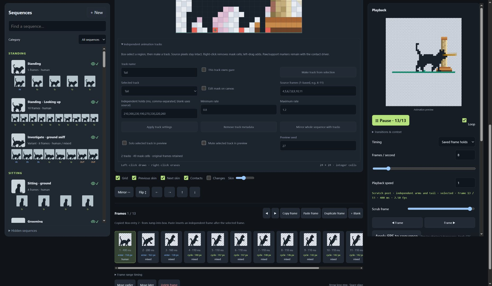

# Independent post-scratch tracks — 17–18 October 2026

The exact derived project `proposal-scratching-post-tracks` is integrated. Its immutable version is `e0766dd95302d68c2dc374c70544d8720b4acdf9672bfb23a40441fbbd419e85`; [source snapshot](source-change.json) and [completed receipt/build hashes](integration-receipt.json) identify this version only.

The parent is the user's refined 13-frame `proposal-scratching-post-action`, hash `dbeac4f74a79b39373b5faff5eb81f6cd435a366be0949c432da17f71d28aa5f`. All rows, roles, holds, anchors, gaze and per-frame human/mixed origins are copied exactly. Frame identities are remapped with parent IDs retained. No pixels were redrawn or relabelled. The original project and prior completed receipt remain intact. Local Studio on 8767 contains this work; hosted read-only MCP still reported no changes/props and was not used as an authoritative replacement.

The additive track definition keeps arms/body as contact driver. A 49-cell tail mask (x2–8/y7–13) selects exact cycle-source pixels, including transparency, with independent holds, phase and 0.8–1.2 rates. Two driver forepaw downstrokes generate deduplicated contact events. Tail composition cannot change planted rear/forepaw cells; enter/exit stay exact flat frames. The shared lazy cache is capped at 128 combinations. Driver gaze remains exact; future head tracks must declare gaze ownership.

Studio supports selection-created named tracks, add/subtract mask painting, membership/holds/rates, seed/solo/mute preview, atomic locks/undo, full-region moves, whole-sequence mirror, duplicate and metadata-preserving JSON export/import. The ordinary editor stays available. Full composed-sheet export and more elaborate attachment groups remain roadmap extensions.

## Runtime refinement evidence

- **Resize:** a separate layout pause gates work before measurement/decisions/scenes; 260 ms quiet plus two stable probes, shared geometry, one actor reconciled per frame, cell-aligned relocation and staggered restart. Manual Pause survives. Active pickup/drop is cancelled safely to avoid a recovery deadlock.
- **Continuity:** stalking stopping allowances no longer turn negative; compatible consecutive bouts retain gait/head phase. Beds approach their rest bearing through visible sneaking frames and gradual lining height; igloo masks admit the outside approach. Managed actors no longer auto-promote onto simple beds near their centre.
- **Shallow crossing:** safe support changes within four native cells of height and two of gap usually walk gradually; ordinary crossings have an 88% walking choice, with independent later choices and optional hops. Faces remain pass-through affordances.
- **Ear scratch:** base selection weight 0.85, retaining 75 ms cycles. The isolated 20-seed/40,000-choice comparison changed 8,016 choices to 7,005, not a promised live percentage.
- **Contact effects:** post translation is lateral only, amplitude 0.28 post cells. Real paw strokes produce rope fibres using one pool/canvas per view: 32 active, six per owner, 12 spawns per active second; known ground, bounded lifetime and 260 ms dissolve. Reduced motion/config/hidden/resize/removal cleanup is tested. Native edges do not wiggle or emit rope.

Validation: both builds; **79/79 suites**, including six-scale/both-facing stalking, bed/shallow continuity, all pilot arm/tail combinations, protected contacts/gaze, exact flat fallback, serialization/transforms/locks, resize clocks/cleanup and effect budgets. Browser testing on 8769 observed real stroke events, lateral deflection and fibres, igloo left entry and simple-bed right entry through to inside/rest. The 512-extra-card/20-cat lab retained 1,050 supports; a real viewport resize settled with one shared scan and preserved a manually paused cat. This is retention/recovery evidence, not a device capacity guarantee. The shared export function passes an exact full-project round trip; the browser download-event handshake stalled and is not claimed as verified.

HA: five affected resource bodies were freshly retrieved/backed up, scoped updates were read back byte-for-byte, and the real playground/stress views rendered without console errors. Twenty stress cats recovered at desktop/narrow breakpoints and showed varied walking/resting/grooming/post use. Dashboard config hash stayed `f31c6fe62a88cd3e`; no dashboard configuration or playground fixture was rewritten. Physical-phone inertia and sustained performance remain unverified.

During browser QA, a startup click added one pixel at frame 1/cell 12,7 to this derived copy. The exact difference was backed up, the tab closed and the copy conditionally restored to the immutable snapshot. The accidental hash `66d80c10f570957b73d02ff2197b8f0dc35aa053fee022e9cbcfb33dadd3b520` remains explicitly deferred/rejected history, never deployed. The editor now starts inert until initialization completes. All pre-existing journal snapshots and the prop workspace were preserved. Final review: 911 journal entries, 95 latest assets, 37 pending; only this exact integrated pilot received a new Completed receipt.
